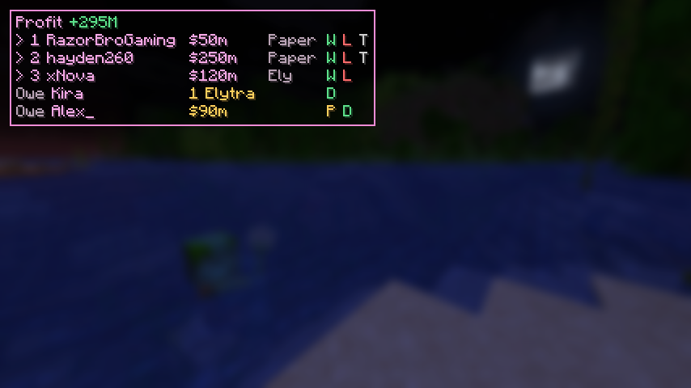

# Donut Gamble Tracker

A client-side Fabric mod for **Minecraft 1.21.11** that tracks gamble bets on Donut SMP
while you stream. When someone `/pay`s you, the bet joins an on-screen queue. You click
who won, and your profit updates live.



## Install

1. Install [Fabric Loader](https://fabricmc.net/use/) for Minecraft 1.21.11.
2. Put [Fabric API](https://modrinth.com/mod/fabric-api) (for 1.21.11) in your `.minecraft/mods` folder.
3. Put `donut-gamble-1.0.0.jar` in `.minecraft/mods` as well.
   - To build it yourself: `./gradlew build`. The jar ends up in `build/libs/`.

## How it works

Every `/pay` you receive joins the queue in the top-left. **#1 is the bet you're playing now.**

```
Profit +295M
> 1 RazorBroGaming  $50m   Paper  W L T
> 2 hayden260       $250m  BJ     W L T
> 3 xNova           $120m  Ely    W L
Owe Kira            1 Elytra            D
Owe Alex_           $90m              P D
```

To click the letters, open chat (`T`) or press `Insert` to free the mouse.

| Click | What it does |
|---|---|
| **W** / **L** / **T** | They won / lost / tied. Ties go to you. A small box then asks for the score (Them / Me). Press Enter to save or Skip. |
| **W** on an Ely bet | They hit the item frame. Confirm the elytra price, and it's counted as your cost. |
| **Paper / BJ / Ely** | Switch the game if the guess from the amount was wrong. |
| **P** | Types `/pay <name> <amount>` in chat (2x their bet). You press Enter to send. |
| **D** | Done: they've been paid, or their elytra is in their order. |
| Right-click a name | Remove a payment that wasn't a bet. |
| Right-click **Profit** | Start a new session (profit back to 0 for a new stream). |

| Key | What it does |
|---|---|
| `Insert` | Free the mouse to click the queue (press again to close) |
| `H` | Show / hide the queue |
| `]` / `[` | #1 in the queue won / lost (no score box) |

Keys can be changed under **Options → Controls → Key Binds → Donut Gamble**.

Game guess from the amount: Paper 5M – 500M, Blackjack 101M – 701M (overlaps use your last
game), anything else is Ely Arrows.

## Files

Everything is saved in `.minecraft/config/donutgamble/` after every change:

- `ledger.json`: every bet, its result and whether it's been paid.
- `config.json`: settings. You can change game ranges, `winMultiplier`, HUD position
  (`hudX`, `hudY`, `hudScale`) and `payPatterns`.

### If payments aren't being detected

The mod reads server messages that look like `Steve paid you $50M` or
`You received $50M from Steve`. If Donut SMP words it differently, add a regex with
`player` and `amount` groups to `payPatterns` in `config.json` and restart the game.
Patterns start with `^` so a player can't fake a payment by typing it in chat.

## Development

- `./gradlew test`: unit tests for amount parsing, payment detection, game guessing, scoring and profit math.
- `./gradlew runClientGameTest`: launches a real client, feeds it fake payments and saves
  screenshots of the queue and score box to `build/run/clientGameTest/screenshots/`.
