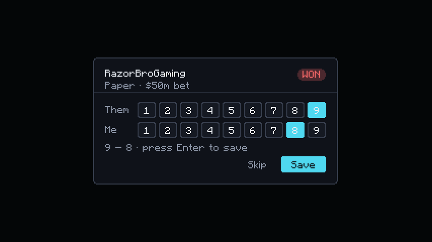
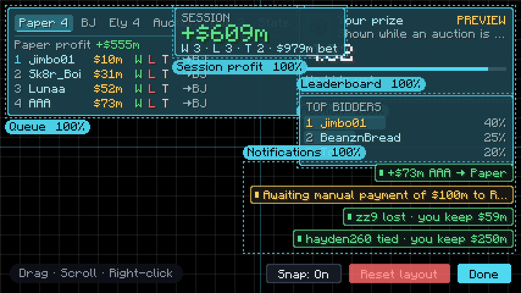
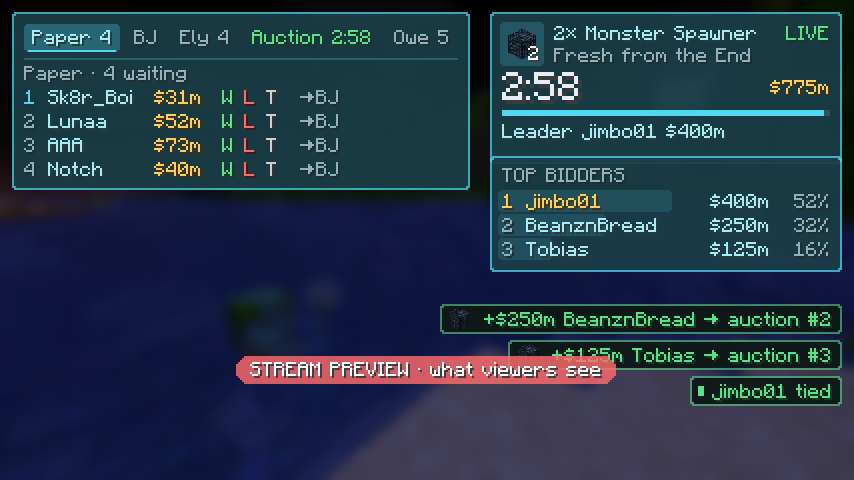
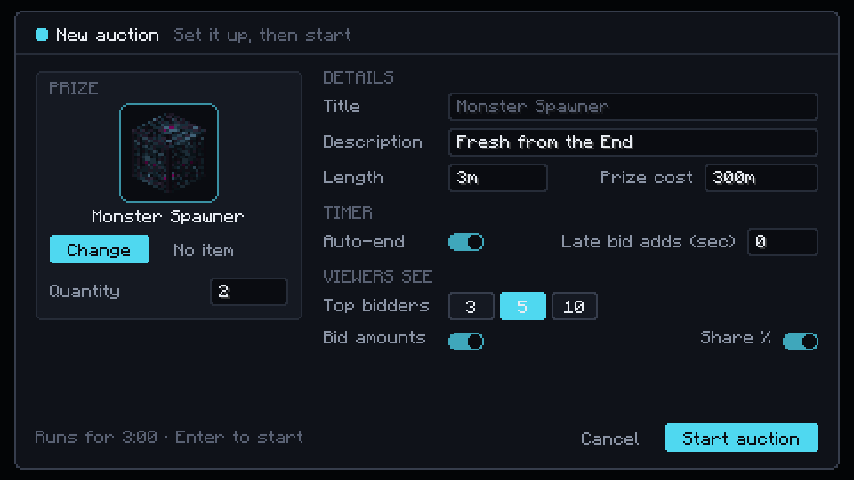
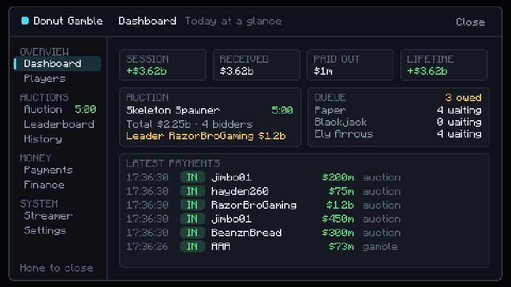

# Donut Gamble Tracker

A client-side Fabric mod for **Minecraft 1.21.11** that tracks gamble bets and auctions on
Donut SMP while you stream. When someone `/pay`s you, the payment joins an on-screen queue (or
the live auction). You click who won, and your profit updates live. A manager window keeps the
books: every payment in and out, auctions, refunds and exports.


## Install

1. Install [Fabric Loader](https://fabricmc.net/use/) for Minecraft 1.21.11.
2. Put [Fabric API](https://modrinth.com/mod/fabric-api) (for 1.21.11) in your `.minecraft/mods` folder.
3. Put `donut-gamble-1.0.0.jar` in `.minecraft/mods` as well.
   - To build it yourself: `./gradlew build`. The jar ends up in `build/libs/`.

## How it works

The queue in the top-left has a tab for each game, plus **Auction**, **Owe** and **Stats**:

| Tab | Shows |
|---|---|
| **Paper** / **BJ** / **Ely** | That game's queue and profit. **#1 is the bet you're playing now.** The number on the tab is how many are waiting. |
| **Auction** | The live auction: prize icon, title, countdown, total, top bidders with their share, and **Pause / +30s / End / Manager**. With no auction running: the last result and **Set up auction**. |
| **Owe** | Everyone you still owe: gamble winners and auction refunds, with the total. |
| **Stats** | Profit, W-L-T and total bet for each game, this session and lifetime. Also **Color** and **New session**. |

```
Paper 6  BJ 1  Ely 4  Auction  Owe 2  Stats
Paper profit +$355m
1  RazorBroGaming  $50m   W L T  →BJ
2  hayden260       $250m  W L T  →BJ
```

New payments go to the tab for the game guessed from the amount. If the tab you have open is
empty, it jumps to the new bet's tab.

To click tabs and letters, open chat (`T`) or press `Insert` to free the mouse.

| Click | What it does |
|---|---|
| A tab | Switch to it. |
| **W** | They won. A pop-up says **"Awaiting manual payment of $100m to …"**, and the score picker opens. |
| **L** | They lost. The score picker opens. |
| **T** | Tie: goes to you. Recorded straight away, no numbers. |
| **W** on an Ely bet | They hit the item frame. Confirm the elytra price, and it's counted as your cost. |
| **→BJ** (etc.) | Move a bet to another game's tab if the guess was wrong. |
| **P** (Owe tab) | Types `/pay <name> <amount>` in chat (2x their bet). You press Enter to send. |
| **D** (Owe tab) | Done: they've been paid, or their elytra is in their order. Money rows also clear on their own when you `/pay` them the exact amount. |
| Right-click a name | Remove a payment that wasn't a bet. |
| **Color** (Stats tab) | Aqua, Purple, Gold, Red, Lime, Pink, White. |
| **New session** (Stats tab) | Profit back to 0 for a new stream. Lifetime is kept. |

| Key | What it does |
|---|---|
| `Insert` | Free the mouse to click or drag the queue (press again to close) |
| `Home` | Open / close the manager |
| `H` | Show / hide the queue |
| `]` / `[` | #1 in the open game tab won / lost (no score picker) |
| `End` | HUD editor |
| (unbound) | Toggle Streamer Mode; set a key under Controls |

Keys can be changed under **Options → Controls → Key Binds → Donut Gamble**.

Game guess from the amount: Paper 5M – 500M, Blackjack 101M – 701M (overlaps use your last
game), anything else is Ely Arrows.

### Score picker



Click the numbers the round ended on, then **Save** (or press Enter). The numbers are optional;
**Skip** keeps the result without them.

- **Paper**: 1 to 9. You can also just type the two digits (theirs, then yours).
- **Blackjack**: 17, 18, 19, 20, 21 or **Bust** (players hit until 17+).
- If the numbers say the opposite of what you clicked, the picker warns you before you save.

### HUD and HUD editor



The HUD is five pieces you can arrange: the **Queue**, the **Auction** card (prize icon, title,
description, countdown, leader; shown only while an auction is live), the **Leaderboard** (top
bidders), **Session profit** (off by default) and **Notifications**. Press `End` (or
**Edit HUD layout** in Settings) to open the editor:

- **Drag** a piece to move it. It snaps to the screen edges, the center and a 4px grid (Snap: On/Off).
- **Scroll** over a piece to resize it (50% to 200%).
- **Right-click** a piece to show or hide it.
- **Reset layout** puts everything back.

The layout is saved. You can also drag pieces while chat or `Insert` is open.

## Streamer Mode



Turn it on in the manager's **Streamer** page (or bind the *Toggle Streamer Mode* key). While it's
on, the mod **doesn't draw** your private figures at all, rather than drawing them and covering
them up:

| Hidden by default | Still shown |
|---|---|
| Session and lifetime profit, received, paid out (Dashboard) | The auction: prize, title, timer, bidders, leader |
| Per-game profit, the Stats tab and the total owed (Queue HUD) | Public bid amounts (switch off with **Auction bids**) |
| Pop-ups about your profit, exports and backups | Payments coming in, who won or lost, who's owed a payout |
| What each player paid you or was paid (Players) | Each player's W-L-T and auction wins |
| Finance and Payments pages, the Session profit HUD, auction profit in History | Game queues, W/L/T letters |

Pop-ups have a public wording: "zz9 lost" instead of "zz9 lost · you keep $59m". Each of the six
areas can be switched separately. **Preview** shows exactly what viewers would see without
turning Streamer Mode on (a red "STREAM PREVIEW" banner marks it).

Streamer Mode only controls what this mod draws in the Minecraft window. It can't hide other apps
or windows your stream captures, so keep exported files and other windows off stream.

## Auctions



1. **Set up auction** (from the Auction tab, the dashboard, or the manager's **Auction** page)
   opens the setup screen:
   - **Prize**: any item. **Choose item** opens the item browser: search every item, browse the
     creative categories (once you're in a world), reuse **Recent** prizes or **Favorites**
     (right-click an item to star it), or take an exact item from your **Inventory**. An
     inventory item keeps its enchantments, custom name and other data.
   - **Quantity**, **Title** (defaults to the item, like "2× Monster Spawner"), **Description**.
   - **Length** (`5m`, `90s`, `2:30`) and **Prize cost** (recorded as an expense).
   - **Timer**: auto-end on/off and how many seconds a late bid adds (anti-snipe), for this auction.
   - **Viewers see**: top 3, 5 or 10 bidders, bid amounts on/off, share % on/off.
2. While it's live, every `/pay` counts toward it instead of the gamble queue. Each player's
   payments add up, and the biggest total leads; on a tie, whoever paid first ranks higher.
3. Pause, resume, add or remove time, end early, or cancel. When the timer hits 0 it ends on its own
   (unless auto-end is off for that auction).
4. On end: the top contributor wins, the prize cost is recorded as an expense, and (if
   **Refund everyone but the winner** is on) everyone else shows up in **Owe** as a refund.
   Cancelling refunds everyone.

The prize icon shows on the HUD, the dashboard, the Auction and Leaderboard pages, History and
auction pop-ups.

Defaults in **Settings**: payments go to the auction (on/off), auto-end, refund non-winners,
anti-snipe, minimum auction payment (smaller payments go to the gamble queue), and the default length.

A live auction is paused if you close the game, so no time is lost. Resume it from the Auction tab.

## Manager (`Home`)



| Section | What's there |
|---|---|
| **Dashboard** | Session and lifetime net, received, paid out; the live auction; queue counts; latest payments. |
| **Players** | Everyone who has paid, bet or bid. Search, then click one: paid you, you paid, net, W-L-T, wagered, bets net, auction bids and wins, recent payments. |
| **Auction** | Recent prizes and **Set up auction**, or the big countdown with Pause / ±30s / +5m / End now / Cancel, top contributors, and **manual correction** (add or take away from a player's auction total). |
| **Leaderboard** | Full ranking of the live or last auction: total, number of payments, share. Scroll for more. |
| **Payments** | Every payment in and out, newest first. **Search** by player, amount (`200m`), type or source. Click a name for that player's history. **void / undo** takes an entry out of every total (and out of the queue or auction it went to). Add a missed payment or payout by hand. Export **CSV** / **JSON**. |
| **Finance** | Session and lifetime: received (from gamble / auction / other), paid out, expenses, net profit, counts, game results; top payers; add an expense; **Export report**. |
| **Auction History** | Every finished auction; click one for its summary (winner, total, prize cost, top 5, refunds still owed). Export CSV / JSON. |
| **Streamer** | Streamer Mode on/off, **Preview**, and what to hide (six switches). |
| **Settings** | Auction rules, color, pop-ups, **Edit HUD layout**, duplicate window, elytra price, **Back up** / **Open folder**. Typed values apply when you press Enter. |

The manager is laid out for at least 480×270 GUI pixels. If your GUI scale leaves less room, it
draws at the next smaller whole scale so text stays sharp instead of overlapping.

### How the money is counted

- **Received**: every incoming `/pay`, whether it went to a bet or an auction.
- **Paid out**: every `You paid X $ …` the server shows you. A payout that matches an owed
  winner or refund also clears that row.
- **Expenses**: elytras you deliver (pressing **D** on an Ely win), auction prize costs, and
  anything you add by hand.
- **Net profit** = received − paid out − expenses. "Game results" (win/loss from bets) is
  shown separately.
- The same player paying the same amount twice within 1.5 s is counted once (the server or
  another mod echoing the line). Change or turn off the window in Settings.

## Files

Everything is saved in `.minecraft/config/donutgamble/` after every change:

- `ledger.json`: every bet, its result and whether it's been paid.
- `finance.json`: every payment in and out, expenses and corrections.
- `auctions.json`: the live auction, past auctions and refunds.
- `exports/`: CSV / JSON / report files from the manager.
- `backups/`: a copy of all of the above once a day (last 7 days kept) plus any **Back up** you make.
  If a file is ever unreadable, the mod loads the newest backup instead of starting empty, and
  keeps the bad file as `*.broken`.

Saving happens in the background a moment after each change, and everything is written when the
game closes, so a busy stream never stutters.
- `config.json`: settings. You can change game ranges, `winMultiplier`, HUD position
  (`hudX`, `hudY`, `hudScale`), `theme` and `extraPayPatterns`.

### Payment messages

The mod reads Donut SMP's own server messages, like `jimbo01 paid you $ 75M`.
When you send a payout and the server says `You paid Alex_ $ 90M`, the matching **Owe**
row clears automatically. Messages typed by players in chat are ignored, so nobody can fake
a payment.

If payments ever stop showing up (for example, the server changes its wording), add a regex
with `player` and `amount` groups to `extraPayPatterns` in `config.json` and restart the game.

## Development

- `./gradlew test`: unit tests for amount parsing, payment detection, game guessing, scoring,
  profit math, auctions, the finance book, duplicate detection and CSV export.
- `./gradlew runClientGameTest`: launches a real client, feeds it fake payments (gambling, then
  an auction with a duplicate, a correction, a void, refunds and exports, then an item auction
  set up through the setup screen), checks the results, and saves screenshots of every screen to
  `build/run/clientGameTest/screenshots/`. It also turns on Streamer Mode, records every string
  the mod draws on every HUD tab and manager page, and fails if any private figure is among them.
