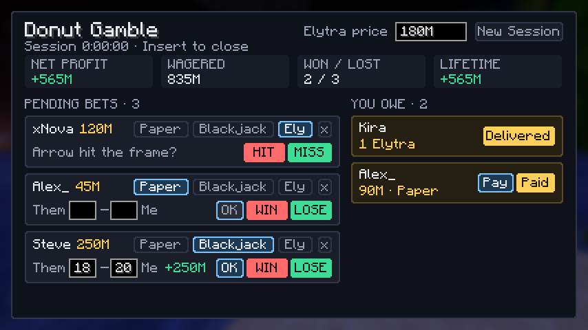
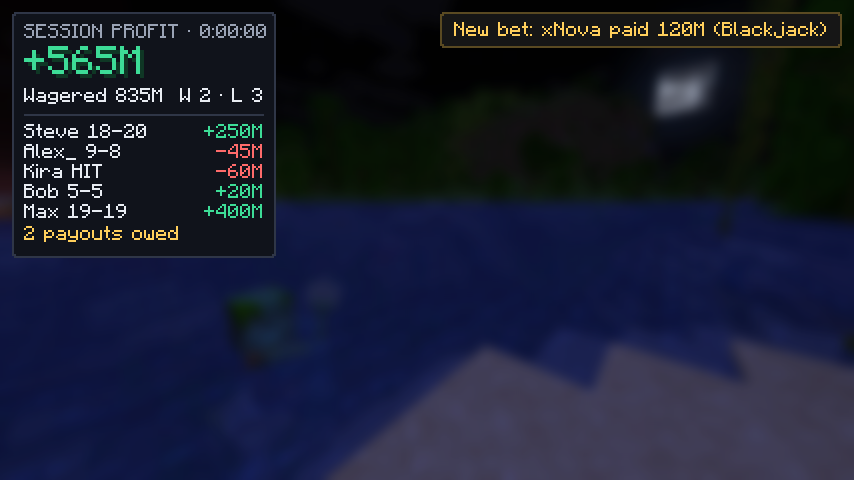

# Donut Gamble Tracker

A client-side Fabric mod for **Minecraft 1.21.11** that tracks gamble bets on Donut SMP
while you stream. When someone `/pay`s you, the bet shows up in a panel. You call the
result, and your profit updates live on screen.

## Install

1. Install [Fabric Loader](https://fabricmc.net/use/) for Minecraft 1.21.11.
2. Put [Fabric API](https://modrinth.com/mod/fabric-api) (for 1.21.11) in your `.minecraft/mods` folder.
3. Put `donut-gamble-1.0.0.jar` in `.minecraft/mods` as well.
   - To build it yourself: `./gradlew build`. The jar ends up in `build/libs/`.

## Controls

| Key | What it does |
|---|---|
| `Insert` | Open / close the gamble panel |
| `H` | Show / hide the profit HUD |
| `]` | Newest pending bet: player **wins** |
| `[` | Newest pending bet: player **loses** |

All keys can be changed under **Options → Controls → Key Binds → Donut Gamble**.

## How a bet works

1. A player does `/pay <you> <amount>`. A **New bet** banner pops up, and the bet shows
   in the panel under **Pending Bets**.
2. The mod guesses the game from the amount:
   - Paper: 5M – 500M
   - Blackjack: 101M – 701M
   - Overlapping amounts use the last game you played. Anything outside both ranges is Ely Arrows.
   - Click **Paper / Blackjack / Ely** on the card to change it.
3. Call the result:
   - **Paper / Blackjack**: type the score as **Them – Me** and press **Enter** (or **OK**).
     Higher score wins, and **ties go to you**. In blackjack, going over 21 is a bust.
     The **WIN / LOSE** buttons work without a score and override it.
   - **Ely Arrows**: **HIT** if the arrow landed on the item frame (they win), **MISS** if it didn't.
4. Wins go to **You Owe**:
   - Paper / Blackjack pay **2x the bet**. **Pay** types `/pay <name> <amount>` into chat
     for you to send. Press **Paid** once it's sent.
   - Ely Arrows: "1 Elytra · fill their order". The current **Elytra price** (set it at the
     top of the panel) counts as your cost. Press **Delivered** once you've filled their order.
5. **x** on a card removes a payment that wasn't a bet.

The HUD (top-left) shows session profit, total wagered, wins/losses, your last 5 results
with scores, and how many payouts you still owe. **New Session** resets the session
numbers for a new stream. Lifetime profit is kept separately.

## Files

Everything is saved in `.minecraft/config/donutgamble/` after every change:

- `ledger.json`: every bet, its result and whether it's been paid.
- `config.json`: settings. You can change game ranges, `winMultiplier`, HUD position
  (`hudX`, `hudY`, `hudScale`), the accent color and `payPatterns`.

### If payments aren't being detected

The mod reads server messages that look like `Steve paid you $50M` or
`You received $50M from Steve`. If Donut SMP words it differently, add a regex with
`player` and `amount` groups to `payPatterns` in `config.json` and restart the game.
Patterns start with `^` so a player can't fake a payment by typing it in chat.

## Development

- `./gradlew test`: unit tests for amount parsing, payment detection, game guessing, scoring and profit math.
- `./gradlew runClientGameTest`: launches a real client, feeds it fake payments and saves
  screenshots of the HUD and panel to `build/run/clientGameTest/screenshots/`.
