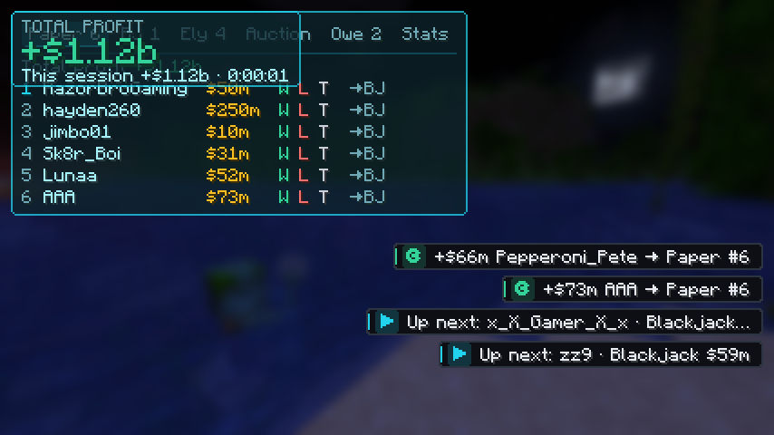

# Donut Gamble Tracker

A client-side Fabric mod for **Minecraft 1.21.11** that tracks gamble bets on Donut SMP
while you stream. When someone `/pay`s you, the bet joins an on-screen queue. You click
who won, and your profit updates live.



## Install

1. Install [Fabric Loader](https://fabricmc.net/use/) for Minecraft 1.21.11.
2. Put [Fabric API](https://modrinth.com/mod/fabric-api) (for 1.21.11) in your `.minecraft/mods` folder.
3. Put `donut-gamble-1.0.0.jar` in `.minecraft/mods` as well.
   - To build it yourself: `./gradlew build`. The jar ends up in `build/libs/`.

## How it works

The queue in the top-left has a tab for each game, plus **Owe** and **Stats**:

| Tab | Shows |
|---|---|
| **Paper** / **BJ** / **Ely** | That game's queue and profit. **#1 is the bet you're playing now.** The number on the tab is how many are waiting. |
| **Owe** | Everyone you still owe ("awaiting manual payment of $90m"), the total, and which game they won. |
| **Stats** | Profit, W-L-T and total bet for each game, this session and lifetime. Also **Color** and **New session**. |

```
Paper 6  BJ 1  Ely 4  Owe 2  Stats
Paper profit +355M
> 1 RazorBroGaming  $50m   W L T  →BJ
> 2 hayden260       $250m  W L T  →BJ
```

New payments go to the tab for the game guessed from the amount. If the tab you have open is
empty, it jumps to the new bet's tab.

To click tabs and letters, open chat (`T`) or press `Insert` to free the mouse.

| Click | What it does |
|---|---|
| A tab | Switch to it. |
| **W** | They won. A box opens saying "Awaiting manual payment of $100m" with the score (Them / Me). Press Enter to save or Skip. |
| **T** | Tie (goes to you). The same score box opens. |
| **L** | They lost. Recorded straight away, no box. |
| **W** on an Ely bet | They hit the item frame. Confirm the elytra price, and it's counted as your cost. |
| **→BJ** (etc.) | Move a bet to another game's tab if the guess was wrong. |
| **P** (Owe tab) | Types `/pay <name> <amount>` in chat (2x their bet). You press Enter to send. |
| **D** (Owe tab) | Done: they've been paid, or their elytra is in their order. Money rows also clear on their own when you `/pay` them the exact amount. |
| Right-click a name | Remove a payment that wasn't a bet. |
| **Color** (Stats tab) | Aqua, Purple, Gold, Red, Lime, Pink, White. |
| **New session** (Stats tab) | Profit back to 0 for a new stream. Lifetime is kept. |

| Key | What it does |
|---|---|
| `Insert` | Free the mouse to click the queue (press again to close) |
| `H` | Show / hide the queue |
| `]` / `[` | #1 in the open game tab won / lost (no score box) |

Keys can be changed under **Options → Controls → Key Binds → Donut Gamble**.

Game guess from the amount: Paper 5M – 500M, Blackjack 101M – 701M (overlaps use your last
game), anything else is Ely Arrows.

## Files

Everything is saved in `.minecraft/config/donutgamble/` after every change:

- `ledger.json`: every bet, its result and whether it's been paid.
- `config.json`: settings. You can change game ranges, `winMultiplier`, HUD position
  (`hudX`, `hudY`, `hudScale`), `theme` and `extraPayPatterns`.

### Payment messages

The mod reads Donut SMP's own server messages, like `jimbo01 paid you $ 75M`.
When you send a payout and the server says `You paid Alex_ $ 90M`, the matching **Owe**
row clears automatically. Messages typed by players in chat are ignored, so nobody can fake
a payment.

If payments ever stop showing up (for example, the server changes its wording), add a regex
with `player` and `amount` groups to `extraPayPatterns` in `config.json` and restart the game.

## Development

- `./gradlew test`: unit tests for amount parsing, payment detection, game guessing, scoring and profit math.
- `./gradlew runClientGameTest`: launches a real client, feeds it fake payments and saves
  screenshots of the queue and score box to `build/run/clientGameTest/screenshots/`.
